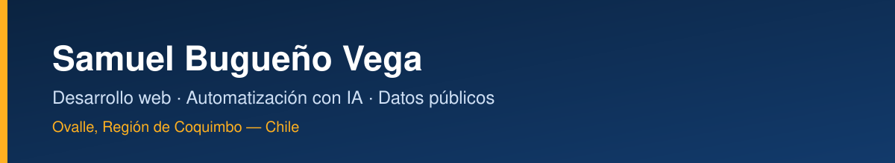

       

## Sobre mí

Estudiante de desarrollo en Ovalle, Región de Coquimbo (Chile). Dirijo productos de punta a
punta: la idea, el diseño y las decisiones son mías; la IA escribe código bajo mi dirección,
y nada sale a producción sin verificación automatizada que lo respalde.

## 🚀 Ahora

| | Proyecto | Estado |
|---|---|---|
| 💰 | [FinControl](https://github.com/samueleduardobuguenovega-lang/FinControl) — Android en Java para gastos y suscripciones, con seguridad como tema central: PBKDF2, Keystore, SQL parametrizado y mapa de gastos. En detalle: [informe de vulnerabilidades corregidas](https://github.com/samueleduardobuguenovega-lang/FinControl/blob/main/vulnerabilities.md). | última edición 30 oct |
| 🧭 | **Brújula** — orientación vocacional y costo real de estudiar en la Región de Coquimbo (SIES, INE, Mineduc). Beta en desarrollo. | sitio vivo · beta |
| 🛡️ | **Bodega Android** — colaboración en `SistemaBodegaAppAndroid` con @Benjaclownstar: PRs y revisión en el sistema de bodega. | en curso |

### **[→ Abrir Brújula: brujula-coquimbo.web.app](https://brujula-coquimbo.web.app)**

## 🏪 Productos reales en producción

> Programas que **ya están desplegados y en uso**: entra, úsalo y juzga por ti mismo.
> Su código es privado; los repos abiertos están en la sección siguiente.

- 🌭 **Los Ñeñecos** — menú digital y sistema de pedidos para la local: catálogo en vivo, carrito,
  checkout, panel de cocina y administración con roles. *SvelteKit 5 · TypeScript · Firebase ·
  Vitest + Playwright.* **[→ Sitio en vivo](https://nenekos-c1e77.web.app)**
- 🖤 **GA Streetwear (Giovani Ambiziosi)** — e-commerce de marca (Drop 01) con catálogo de
  ediciones numeradas, carrito y pedido directo por WhatsApp/Instagram con panel de
  administración. *SvelteKit 5 · Tailwind 4.* Despliegue de demo en LAN.

## 📦 Código abierto

Actividades y sistemas de curso (IEI-093, Programación Android), abiertos con sus
errores y todo. Cada nombre lleva al repo con la explicación a fondo:

- 🗺️ [SimpleGPSMapApp](https://github.com/samueleduardobuguenovega-lang/SimpleGPSMapApp) — Google
  Maps + GPS con `FusedLocationProvider`, marcadores, geocodificación en hilos, cámara y pruebas unitarias.
- 💰 [FinControl](https://github.com/samueleduardobuguenovega-lang/FinControl) — el proyecto "Ahora",
  con su auditoría de seguridad y correcciones documentadas.
- 🎬 [SimpleMultimediaApp](https://github.com/samueleduardobuguenovega-lang/SimpleMultimediaApp) —
  imagen, audio, video, animación y permisos en tiempo de ejecución.
- 🧵 [Semana7Actividad22ThreadsYSensores](https://github.com/samueleduardobuguenovega-lang/Semana7Actividad22ThreadsYSensores)
  — threads, `AsyncTask`, sensores de rotación y acelerómetro.
- 💬 [Semana06Actividad21](https://github.com/samueleduardobuguenovega-lang/Semana06Actividad21)
  — intents explícitos e implícitos: cámara, datos entre Activities y compartir.
- 📦 [sistema en colaboración](https://github.com/Benjaclownstar/SistemaBodegaAppAndroid) — bodega
  con roles y stock, revisada en PRs.

## Cómo trabajo

- **La dirección es mía; el código, coescrito con IA:** especifico, diseño, reviso y audito.
- **Verificación antes de publicar:** pruebas automáticas (lógica, múltiples pantallas, cero
  errores de consola); si algo falla, no queda publicado.
- **Datos con fuente:** cada cifra va con su origen y su año a la vista.
- **Aprendiendo en público:** mis repos de curso están abiertos, con sus errores incluidos.

## Stack

| Capa | Tecnologías |
|------|-------------|
| Copiloto | Desarrollo dirigido por IA: LLMs y agentes de código, con revisión y verificación humana |
| Frontend | SvelteKit 5 · Svelte 5 · TypeScript · Tailwind CSS 4 · CSS propio por capas |
| Móvil | Android nativo · Java · Gradle KTS · componentes de UI reutilizables |
| Backend y datos | Firebase (Firestore, Auth, Functions) · Node.js · APIs REST |
| Pruebas | Playwright · Vitest · scripts de auditoría propios |
| Infra | Docker · GitHub Actions · despliegue en servidor propio |

---

## Estado y actividad

### 🐍 Mi serpiente de contribuciones

<picture>
  <source media="(prefers-color-scheme: dark)" srcset="https://raw.githubusercontent.com/samueleduardobuguenovega-lang/samueleduardobuguenovega-lang/output/github-contribution-grid-snake-dark.svg" />
  <source media="(prefers-color-scheme: light)" srcset="https://raw.githubusercontent.com/samueleduardobuguenovega-lang/samueleduardobuguenovega-lang/output/github-contribution-grid-snake.svg" />
  
</picture>

Ovalle, Región de Coquimbo · Chile — aprendiendo a construir con IA, con productos reales incluidos. Colaboraciones bienvenidas.

