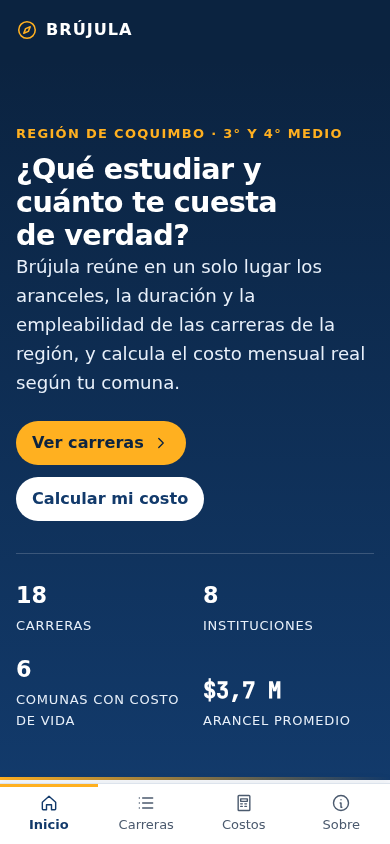
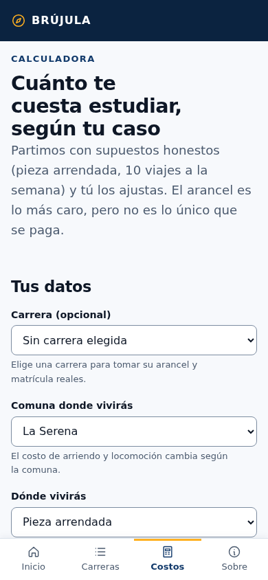
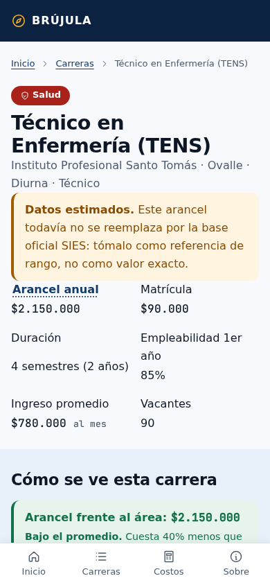
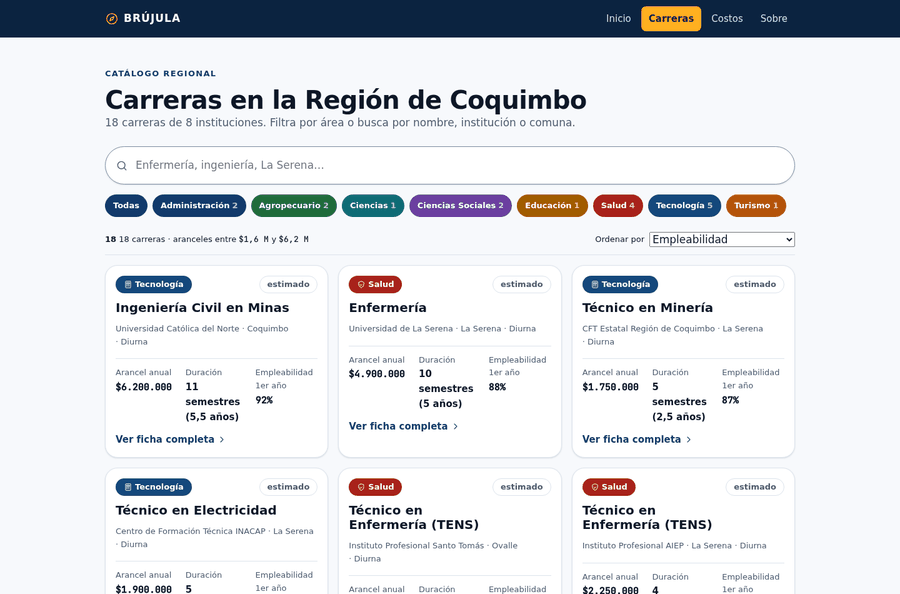
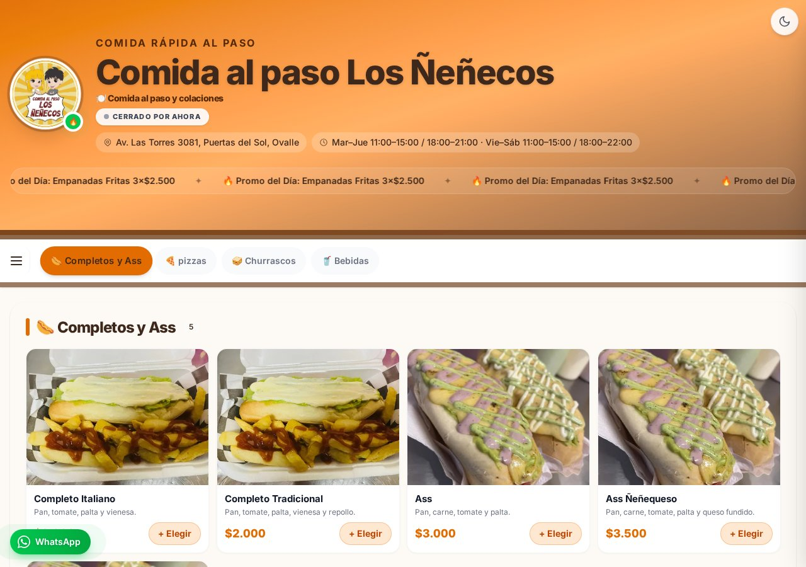
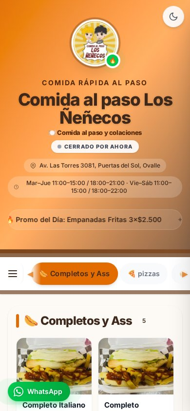
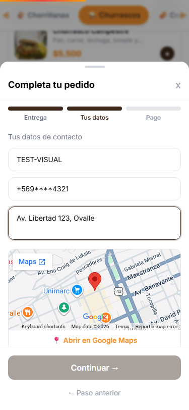
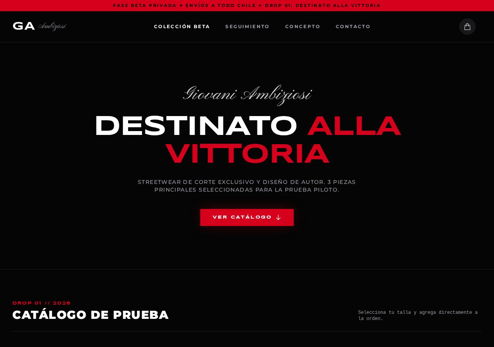
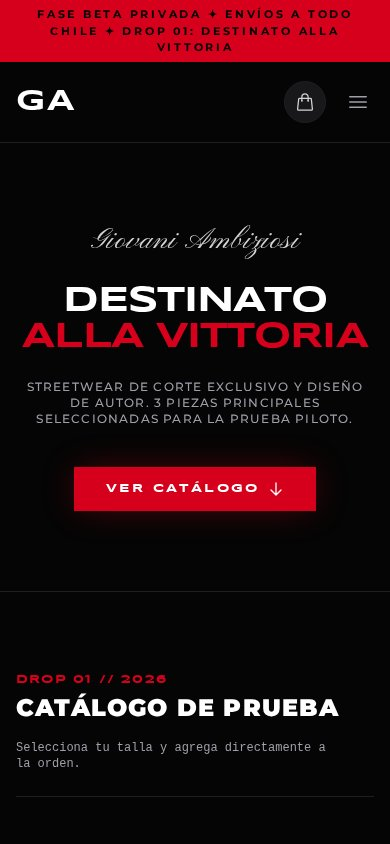

        

## Sobre mí

Estudiante de desarrollo Android desde Ovalle, Región de Coquimbo (Chile). Y lo digo claro,
porque prefiero la verdad antes que el marketing:

> **Si le quito la IA a lo que hago, no sé programar ni una calculadora.**
> Con IA, en cambio, entrego productos completos: los que ves abajo funcionan, están
> desplegados y personas reales los usan.

Mi parte del trabajo es la idea, el diseño, las decisiones de producto, la integración, la
verificación con pruebas automatizadas y el pulido final. La IA escribe código conmigo y yo
la dirijo, la reviso y la audito. Los fundamentos los voy aprendiendo en el camino — en
público, con sus errores incluidos.

## Lo que hago

- **Dirijo productos de punta a punta**: la especificación, el diseño y las decisiones son
  mías; la IA escribe código bajo mi dirección y revisión.
- **Apps web reales y desplegadas**: menús digitales, pedidos, e-commerce y datos públicos.
- **Apps Android en Java**, aprendiendo el oficio con la IA como tutor y pair programmer.
- **Verificación automatizada**: Vitest + Playwright sobre GitHub Actions; no publico si
  algo falla.
- **Datos con fuente:** cada cifra va con su origen y su año a la vista.

## Proyectos

> La mayoría de estos productos está **desplegada y abierta al público**: entra, úsalo y
> juzga por ti mismo. Su código es privado. Lo que sí está abierto: mis apps de Android y
> mis actividades de curso, al final de esta sección.

### 🧭 Brújula — orientación vocacional y costo real de estudiar

Web para estudiantes de 3° y 4° medio de la Región de Coquimbo: **cuánto cuesta realmente
estudiar** una carrera, cuánto se gana después y qué alternativas existen cerca de casa.
Datos de fuentes públicas (SIES, INE, Mineduc), calculadora con desglose de costos y
comparación de cada carrera contra el promedio de su área.

571 carreras · 18 instituciones · cada cifra con su fuente y su año a la vista.

### **[→ Abrir el sitio: brujula-coquimbo.web.app](https://brujula-coquimbo.web.app)**

*SvelteKit 5 · TypeScript · CSS propio por capas · sin dependencias de interfaz · beta en desarrollo.*

<table>
<tr>
<td width="33%"> Portada</td>
<td width="33%"> Calculadora de costos</td>
<td width="33%"> Ficha de carrera</td>
</tr>
</table>

### 🌭 Los Ñeñecos — menú digital y pedidos para un local de comida al paso

PWA de menú digital y pedidos para **Comida al Paso Los Ñeñecos** (Ovalle). El cliente entra
desde el teléfono, arma su pedido y lo envía sin instalar nada; el local lo recibe en una
pantalla de cocina.

Catálogo en vivo sincronizado con Firestore, carrito y checkout, **panel de cocina** para
seguir el estado de cada pedido, panel de administración con roles (productos, categorías,
precios y promociones), botón directo de WhatsApp, modo oscuro y QA automatizado con
Vitest + Playwright sobre GitHub Actions.

### **[→ Abrir el menú: nenekos-c1e77.web.app](https://nenekos-c1e77.web.app)**

*SvelteKit 5 · TypeScript · Tailwind CSS 4 · Firebase (Firestore, Auth, Hosting) · PWA.*

<table>
<tr>
<td width="33%"> Menú en escritorio</td>
<td width="33%"> La vista que usa el cliente</td>
<td width="33%"> Checkout paso a paso</td>
</tr>
</table>

### 🖤 GA Streetwear — e-commerce de una marca de ropa

Tienda online para la marca de streetwear **Giovani Ambiziosi** (Drop 01 · *Destinato alla
Vittoria*): catálogo con selección de tallas, estados de inventario, carrito persistente,
checkout guiado con retiro o delivery, seguimiento del pedido para el cliente y panel de
administración completo.

Es una **marca ficticia**: la armé como pieza de portafolio para construir la identidad
visual, el flujo de compra y el panel de admin de punta a punta, sin depender de un cliente
real.

<table>
<tr>
<td width="50%"> Portada (escritorio)</td>
<td width="50%"> Portada (teléfono)</td>
</tr>
</table>

*SvelteKit 5 · TypeScript 6 · Tailwind CSS 4 · Playwright · catálogo de prueba, sin backend real.*

### 📦 BodegaExpress — gestión de bodega en Android

App Android **nativa en Java** que cubre el ciclo completo de una bodega: inicio de sesión con
roles, alta, edición y búsqueda de productos, registro de entradas y salidas con validación de
stock, dashboard de indicadores y alerta de stock bajo.

La resolví como sistema, no como ejercicio: capas separadas (`data` · `model` · `ui` · `util`)
sobre un repositorio con semilla de datos, y un módulo de UI propio con vistas reutilizables
(cabeceras de sección, campos de formulario y badges de estado) en lugar de repetir la
interfaz pantalla por pantalla.

*Android SDK nativo · Java · Gradle Kotlin DSL · RecyclerView · ConstraintLayout.*

### 🔓 Código abierto — Android y actividades de curso

- 🗺️ [SimpleGPSMapApp](https://github.com/samueleduardobuguenovega-lang/SimpleGPSMapApp) —
  Android en Java con Google Maps, GPS en tiempo real (FusedLocationProvider), marcadores del
  usuario y captura de fotos, con pruebas unitarias incluidas.
- 🎬 [SimpleMultimediaApp](https://github.com/samueleduardobuguenovega-lang/SimpleMultimediaApp) —
  Android en Java con imagen, audio, video, animación y permisos en tiempo de ejecución.
- 📚 Actividades de curso (IEI-093):
  [Semana7Actividad22ThreadsYSensores](https://github.com/samueleduardobuguenovega-lang/Semana7Actividad22ThreadsYSensores)
  (threads y sensores) ·
  [Semana06Actividad21](https://github.com/samueleduardobuguenovega-lang/Semana06Actividad21).

## Cómo trabajo

- **La dirección es mía; el código, coescrito con IA:** especifico, diseño, reviso y audito
  todo lo que la IA produce conmigo. Nada llega a producción sin pruebas que lo respalden.
- **Pruebas antes de publicar:** cada entrega corre verificaciones automáticas (lógica de
  dominio, render en varios tamaños de pantalla, cero errores de consola) y no se publica si
  algo falla.
- **Accesibilidad y rendimiento** como parte del trabajo, no como extra.
- **Documentación** para que el proyecto siga vivo sin mí.
- **Aprendiendo en público:** estudio fundamentos de Java y Android (IEI-093) mientras
  entrego; mis repos de actividades están abiertos, con sus errores y todo.

## Stack

| Capa | Tecnologías |
|------|-------------|
| Copiloto | Desarrollo dirigido por IA: LLMs y agentes de código, con revisión y verificación humana |
| Frontend | SvelteKit 5 · Svelte 5 · TypeScript · Tailwind CSS 4 · CSS propio por capas |
| Móvil | Android nativo · Java · Gradle KTS · componentes de UI reutilizables |
| Backend y datos | Firebase (Firestore, Auth, Functions) · Node.js · APIs REST |
| Pruebas | Playwright · Vitest · scripts de auditoría propios |
| Infra | Docker · GitHub Actions · despliegue en servidor propio |

---

## Estado y actividad

### 🐍 Mi serpiente de contribuciones

<picture>
  <source media="(prefers-color-scheme: dark)" srcset="https://raw.githubusercontent.com/samueleduardobuguenovega-lang/samueleduardobuguenovega-lang/output/github-contribution-grid-snake-dark.svg" />
  <source media="(prefers-color-scheme: light)" srcset="https://raw.githubusercontent.com/samueleduardobuguenovega-lang/samueleduardobuguenovega-lang/output/github-contribution-grid-snake.svg" />
  
</picture>

Ovalle, Región de Coquimbo · Chile — aprendiendo a construir con IA, con productos reales incluidos. Colaboraciones bienvenidas.

